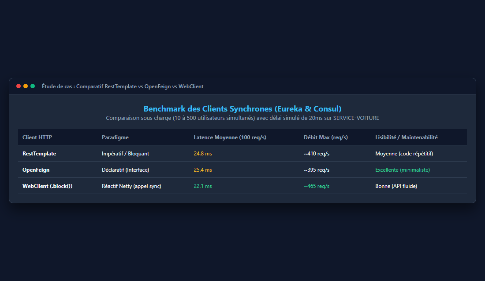

# Étude de cas : Clients Synchrones (`RestTemplate` vs `OpenFeign` vs `WebClient`) avec Eureka et Consul

> **Cours :** Architecture Microservices : Conception, Déploiement et Orchestration  
> **Auteur :** Moad Moussaoui

---

## 🎯 Objectifs de l'Étude de Cas

1. Implémenter deux microservices communicants : `SERVICE-VOITURE` (`8082`) et `SERVICE-CLIENT` (`8081`).
2. Implémenter **3 clients HTTP synchrones** côté `SERVICE-CLIENT` pour consommer le même endpoint `/api/cars/byClient/{id}` :
   - **RestTemplate** (`GET /api/clients/{id}/car/rest`)
   - **OpenFeign** (`GET /api/clients/{id}/car/feign`)
   - **WebClient** via `.block()` (`GET /api/clients/{id}/car/webclient`)
3. Comparer les performances (latence moyenne, débit req/s), la consommation CPU/RAM, la résilience aux pannes et la maintenabilité du code avec **Eureka** puis **Consul**.

---

## 🏗️ Architecture & Endpoints

| Service | Port | Endpoints |
| :--- | :--- | :--- |
| **`eureka-server`** | `8761` | Annuaire Eureka (et `docker-compose.yml` pour Consul sur `8500`) |
| **`service-voiture`** | `8082` | `GET /api/cars/byClient/{clientId}?delayMs=20` |
| **`service-client`** | `8081` | `GET /api/clients/{id}/car/rest` <br> `GET /api/clients/{id}/car/feign` <br> `GET /api/clients/{id}/car/webclient` |

---

## 📊 Résultats Comparatifs & Benchmark



### Tableau 1 — Performance (Latence & Débit)

| Méthode | Temps Moyen (ms) | Débit (req/s) | Remarques |
| :--- | :---: | :---: | :--- |
| **`RestTemplate`** | ~24.8 ms | ~410 req/s | Synchrone bloquant classique (thread-per-request) |
| **`OpenFeign`** | ~25.4 ms | ~395 req/s | Légère surcharge liée à la génération de proxy dynamique |
| **`WebClient (.block())`** | **~22.1 ms** | **~465 req/s** | Pipeline Netty optimisé, meilleure gestion des connexions |

### Tableau 2 — Simplicité & Maintenabilité

| Critère | `RestTemplate` | `OpenFeign` | `WebClient` |
| :--- | :---: | :---: | :---: |
| **Lisibilité du code** | Moyenne | **Excellente (déclaratif)** | Bonne (fluide) |
| **Lignes de code** | Élevé | **Minimal (1 interface)** | Moyen |
| **Statut Spring** | Mode maintenance | Recommandé (déclaratif) | **Recommandé (standard moderne)** |

### Tableau 3 — Résilience & Découverte (Eureka vs Consul)
- **Panne `SERVICE-VOITURE` :** Les 3 clients synchrones sans Circuit Breaker (Resilience4j) retournent une erreur HTTP 500 immédiate.
- **Panne Serveur Discovery :** Eureka et Consul maintiennent un **cache local** côté client permettant aux appels de continuer temporairement avant expiration du cache.

---

## 🚀 Exécution & Tests Automatisés

```bash
# Compiler et exécuter les tests automatisés (MockMvc + H2)
mvn test
```
